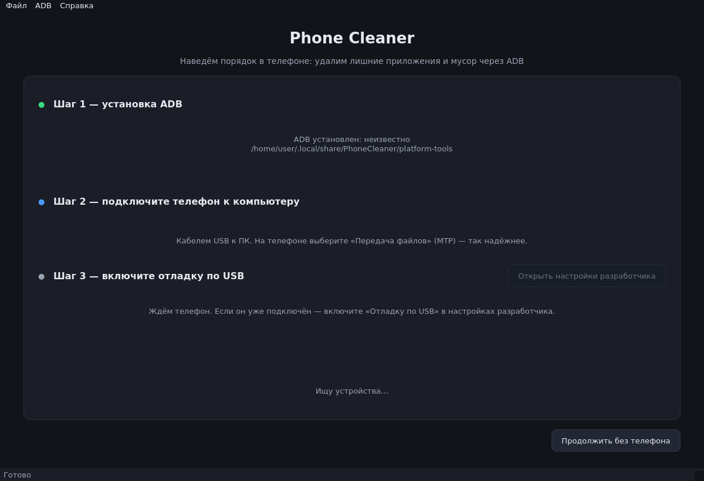
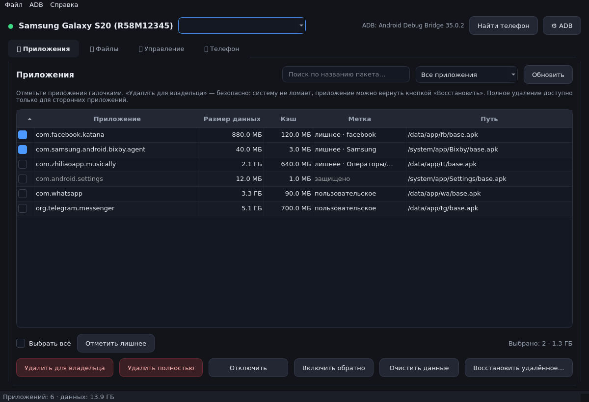

# Phone Cleaner 🧹

**Готовый `PhoneCleaner.exe` (Windows x64, один файл):**
https://github.com/aistreamercs2-cyber/phone-cleaner/releases/download/latest-build/PhoneCleaner.exe




Утилита для Windows (а также Linux/macOS), которая наводит порядок в Android-телефоне через ADB:

1. **Сам ставит ADB** — скачивает самый свежий релиз с GitHub при первом запуске.
2. **Просит подключить телефон** и сам его находит (опрос каждые 2 секунды).
3. **Проверяет отладку по USB** — если выключена, показывает пошаговую инструкцию и может
   открыть экран «Для разработчиков» прямо на телефоне.
4. **Открывает меню очистки**: удаление приложений, заморозка, очистка данных и кэша,
   обзор файлов, управление телефоном командами, скриншоты, установка APK и т.д.

## Что внутри

| Вкладка | Возможности |
|---|---|
| 🧹 **Приложения** | Список пакетов с размерами, поиск, фильтры, отметка «мусора» в один клик, удаление *для владельца* (безопасно и обратимо), полное удаление сторонних приложений, отключение/включение, очистка данных, восстановление удалённых |
| 🗂 **Файлы** | Заполненность хранилища, навигация по папкам телефона, размеры папок, поиск «мусора» по типовым путям, удаление папок/файлов, массовая очистка кэша |
| 🎛 **Управление** | Быстрые команды (Wi-Fi, данные, авиарежим, звук, фонарик, тёмная тема, блокировка, перезагрузка, recovery, bootloader), полноценная консоль ADB с историей, скриншот, запись экрана, установка APK, логи |
| 📱 **Телефон** | Модель, бренд, версия Android, API, архитектура, серийный номер, батарея и температура, разделы хранилища |

## Как запустить из исходников

```bash
python -m venv .venv
source .venv/bin/activate        # Windows: .venv\Scripts\activate
pip install -r requirements.txt
python main.py
```

## Сборка `.exe` (Windows)

**Вариант 1 — двойной клик:** запустить `build_exe.bat`.
Готовый файл появится в `dist\PhoneCleaner.exe` (один файл, ничего ставить не нужно).

**Вариант 2 — вручную:**

```bat
python -m venv .venv
.venv\Scripts\activate
pip install -r requirements.txt pyinstaller
python scripts\make_icon.py
pyinstaller --noconfirm --clean PhoneCleaner.spec
```

**Вариант 3 — готовый exe из CI (ничего устанавливать не нужно):**
workflow `.github/workflows/build-exe.yml` собирает `PhoneCleaner.exe` на `windows-latest`,
прогоняет `PhoneCleaner.exe --selftest` и публикует файл в релизе
[`latest-build`](https://github.com/aistreamercs2-cyber/phone-cleaner/releases/tag/latest-build).
Прямая ссылка на скачивание:
`https://github.com/aistreamercs2-cyber/phone-cleaner/releases/download/latest-build/PhoneCleaner.exe`

Linux/macOS: `./build.sh` → `dist/PhoneCleaner`.

## Как это работает

- **ADB** скачивается с GitHub (`releases/latest`) в `%LOCALAPPDATA%\PhoneCleaner\platform-tools`
  (Linux: `~/.local/share/PhoneCleaner/platform-tools`). Источники проверяются по очереди,
  последний запасной — официальный архив Google. Если ADB уже стоит, он не скачивается заново
  (обновить можно через меню **ADB → Переустановить ADB**).
- **Устройства** опрашиваются `adb devices -l`: состояния `device` (готов), `unauthorized`
  (нужно нажать «Разрешить» на экране телефона), `offline` (переподключить кабель).
- **Удаление приложений** по умолчанию выполняется как `pm uninstall --user 0 <пакет>`:
  приложение исчезает для пользователя, но остаётся в системе, поэтому телефон не «окирпичивается»,
  а вернуть его можно кнопкой «Восстановить» (`cmd package install-existing`).
  Защищённые системные пакеты (SystemUI, Settings, GMS и т.п.) заблокированы от удаления.
- **Размеры** берутся из `dumpsys diskstats` (App Sizes / App Data Sizes / Cache Sizes).

## Структура проекта

```
main.py                     точка входа (её использует PyInstaller)
phone_cleaner/
  adb_installer.py          скачивание/распаковка ADB с GitHub
  adb.py                    обёртка над adb: процессы, пакеты, команды
  parsers.py                парсеры вывода adb (чистые функции)
  paths.py                  пути настроек/логов/ADB
  ui/
    main_window.py          мастер + вкладки
    onboarding.py           шаги 1–2–3 (ADB, кабель, отладка по USB)
    theme.py                тёмная тема, карточки, индикаторы
    tabs/                   apps, files, control, info
tests/                      pytest: парсеры + adb без телефона
scripts/make_icon.py        генерация icon.png / icon.ico
PhoneCleaner.spec           конфигурация PyInstaller
build_exe.bat / build.sh    скрипты сборки
```

## Тесты

```bash
pip install pytest
python -m pytest tests -q
```

Проверка собранного файла без телефона:

```bash
dist\PhoneCleaner.exe --selftest
```

## Безопасность

- Ничего не удаляется без подтверждения.
- Системные пакеты защищены от удаления.
- Все действия — обычные команды ADB, их видно в консоли на вкладке «Управление».

## Требования

- Windows 10/11 (или Linux/macOS), Python 3.10+ для запуска из исходников.
- Драйвер ADB для телефона (Windows обычно ставит автоматически; для некоторых вендоров
  нужен драйвер с сайта производителя).
